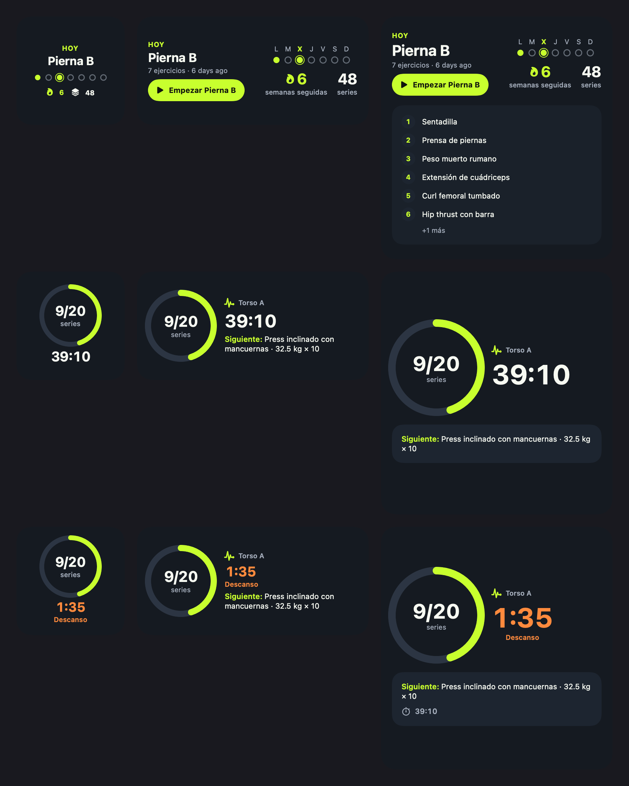

# TrainingHub

A personal workout tracker for planning routines, logging training and seeing
progress over time. Built for daily use on iPhone, with an optional Apple Watch
companion, Live Activities and home-screen widgets.

The project combines a React Native application, a Fastify API and a shared
TypeScript domain package. It is actively developed; implementation status,
deployment and device verification are tracked separately.

## What it does

- Build routines with exercises, rep targets, rest periods, supersets and warm-ups.
- Log working sets, unilateral reps, timed sets and distance; pause and resume
  a workout, including after an app restart.
- Save workouts, browse history and inspect personal records and progress charts.
- Browse a reviewed ES/EN exercise catalog and manage private custom exercises.
- Use kg or lb, Spanish or English, and light or dark appearance.
- On supported Apple devices: follow the active workout and rest timer on the
  lock screen, use the Watch companion, and view training widgets.

The saved active workout works without a connection. Saving to the server and
loading uncached data still require connectivity; a full offline sync engine
is not implemented.

## Native widget preview

Rendered from the widget views with sample values. This is a design render,
not a screenshot of a live account.



## Architecture

| Package | Responsibility | Main technologies |
|---|---|---|
| [Mobile](apps/mobile/README.md) | UI, active-workout draft, device persistence and native bridges | React Native, Expo, Expo Router, TypeScript |
| [API](apps/api/README.md) | Authentication, validation, user-scoped persistence and derived progress | Fastify, Prisma, PostgreSQL |
| [Domain](packages/domain/README.md) | Shared entities, request/response contracts and record rules | Framework-independent TypeScript |

Routine templates and performed workouts are distinct models. Weights are
stored in kg and converted at the display boundary. Progress and records are
derived from saved performed work. See the [architecture guide](docs/codex-project-context.md)
for the boundaries and trade-offs.

## Development environment

The app is used against the existing API and PostgreSQL deployment on a private
server. The mobile development build loads its JS from Metro; standalone
Release builds include their own bundle. Deployment and device details are in
the [deployment guide](docs/deployment.md) and [mobile guide](apps/mobile/README.md).

For working with the repository, use Node **22.13 or newer within the 22.x
release line** and pnpm **9.10.0**. `.nvmrc`, CI and the API image use Node 22.

```bash
nvm use
corepack enable
pnpm install --frozen-lockfile
```

The existing environment supplies the API URL and database/signing credentials.
Private env files and operational addresses are kept outside shared setup
instructions. See [development](docs/development.md) for configuration and
verification; reviewing the source and running tests does not require a new
database deployment.

Use an iOS development build for the full mobile experience. The app uses local
Expo modules, so Expo Go does not provide the full native runtime. Watch,
Health, widgets and notifications need their platforms and permissions.

## Verification

```bash
pnpm --filter @workout/api prisma:generate
pnpm -r typecheck
pnpm -r test
pnpm --filter @workout/api build
```

Unit and route tests use local fixtures and persistence doubles; they do not
need the deployed API or a live database. They verify domain rules, routing,
ownership checks and native-source contracts. Passing them does not replace
real database, signed native-build or device acceptance checks.

## Current scope and next work

- Strict authentication, 90-day credentials and startup validation/offline
  retry are implemented in this checkout. The existing server still needs the
  ordered legacy-data reassignment and rollout described in [0001](docs/sdd/specs/0001-auth-session-hardening/tasks.md).
- [0043](docs/sdd/specs/0043-smarter-warm-ups/tasks.md) is code complete locally:
  configurable personal warm-ups and explained set types. Production rollout
  and physical-device acceptance remain pending.
- [0042](docs/sdd/specs/0042-readable-exercise-progress/tasks.md) is code complete
  locally: trained-exercise search, coherent saved-set evidence and explicit
  progress metrics/periods. API/bundle rollout and device acceptance are pending.
- Apple sign-in, session revocation, production distribution and full offline
  synchronization remain outside the completed scope. Google sign-in requires
  the owner's OAuth configuration.

The [spec backlog](docs/sdd/backlog.md) is the detailed status reference.

## Documentation

- [Documentation index](docs/README.md)
- [Development and verification](docs/development.md)
- [Deployment](docs/deployment.md)
- [Architecture](docs/codex-project-context.md) and [constitution](docs/sdd/constitution.md)
- [Specification workflow](docs/sdd/README.md) and [roadmap](docs/roadmap/README.md)
- [Security and repository sharing](SECURITY.md)
- [Third-party data and assets](docs/data-sources.md)

This repository does not currently grant an open-source license for the
application code. Third-party packages, data and assets retain their own
licenses; see the source notes before redistribution.
